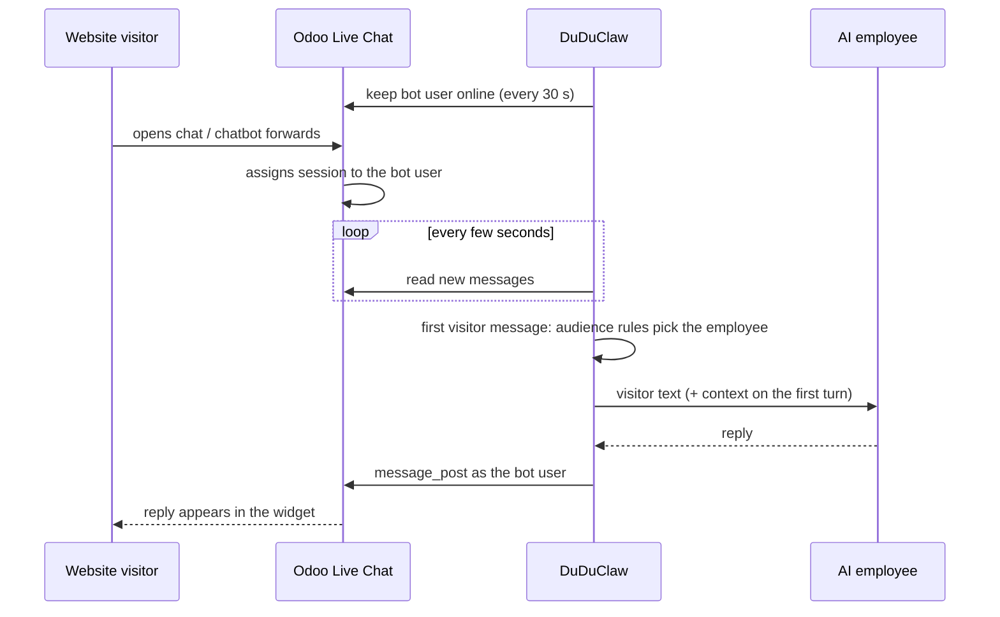

# Odoo website live chat

An AI employee answers the visitors in your Odoo website Live Chat, and audience rules decide which employee talks to which visitor. A VIP customer can get the VIP concierge, a visitor asking about returns the returns specialist, everyone else the front desk. When a person from your team steps into the chat, the AI goes quiet.

Default off. Settings: **Manage → Integrations → Odoo → Website live chat**.

---

## How it works

DuDuClaw joins your Live Chat as an ordinary **operator**. You create a dedicated internal Odoo user (for example "AI Support"), add it to a Live Chat channel's operators, and DuDuClaw keeps that user online. Odoo then assigns visitor chats to it exactly as it would to a person: straight away, or when a Chatbot script reaches a "Forward to Operator" step. DuDuClaw reads the visitor's messages over JSON-RPC every few seconds and replies in the chat as that user.

Why an operator and not a Chatbot script: Odoo's chat widget locks the visitor's input box once a script's last step has run ("This conversation has ended.") unless an operator was found. A script on its own cannot carry an open conversation, so the AI has to be the operator the script forwards to. Odoo also assigns chats only to operators that show as online, which is why DuDuClaw keeps the bot user's presence up:

| Odoo | How the bot stays online |
|---|---|
| 17 / 18 | the bot user calls `bus.presence.update_presence` itself |
| 19 | only administrators may write presence, so DuDuClaw writes the bot's `mail.presence` row through the `[odoo]` connection user, which must have the Administrator role |

When you switch the feature off, or the gateway shuts down normally, the bot is set offline so Odoo stops sending it visitors.



## Setting it up

In Odoo (17 or later, Live Chat app installed):

1. Create an internal user for the bot (Settings → Users), for example "AI Support". Give it the **Live Chat: User** right. Visitors see this name.
2. Sign in as that user and create an API key (Preferences → Account Security → New API Key).
3. In Live Chat → Configuration → Channels, open the channel and add the bot user under **Operators**. To have the AI take every chat, make it the only operator; with people online too, Odoo spreads chats between them.
4. Optional: let a Chatbot script greet visitors first and end a branch with **Forward to Operator**. The AI picks the chat up from there, and you can route by which script forwarded it.

In DuDuClaw:

1. Set up the Odoo connection at the top of the Odoo tab, if you have not.
2. Under **Website live chat**, enter the bot login and API key, then press **Test bot user**. The test signs in as the bot and lists your Live Chat channels (and whether the bot is an operator in each), your Chatbot scripts and your Odoo users. It warns when the bot shares the `[odoo]` connection user, when it is not an operator anywhere, and on Odoo 19 about the Administrator requirement.
3. Pick the **default AI employee**, optionally a greeting, the Odoo users to invite on handoff, and your audience rules.
4. Switch it on and save. It takes effect within seconds, with no restart.

Choose AI employees meant for customers. A public visitor can type anything, so give these employees only the tools a customer conversation needs (for example `allowed_tools = ["mcp__duduclaw__wiki_search"]`) and the product knowledge to answer from (wiki pages). An employee with no knowledge of your prices will invent them.

## Audience routing (分眾)

Each session is matched once, on the visitor's first message, against your rules from top to bottom. The first enabled rule whose conditions all hold picks the AI employee; with no match the default employee answers. The choice stays for the rest of that chat, so the visitor never sees a different employee halfway through.

| Condition | Where the value comes from |
|---|---|
| Live Chat channels | the `im_livechat.channel` that served the visitor |
| Forwarded by chatbot | the Chatbot script that forwarded the visitor to an operator (its branch is the visitor's own choice of topic) |
| Visitor type | logged in to your website (an Odoo contact) or anonymous |
| Customer tags | the logged-in contact's tags, for example `VIP` |
| Country codes | the country Odoo derives from the visitor's IP (`TW`, `JP`) |
| Languages | the visitor's Odoo language; `zh_TW` matches exactly, `zh` matches every Chinese variant |
| Message keywords | the visitor messages that are still unanswered when the AI employee takes over (usually what they write right after the chatbot forwards them); options clicked in a chatbot script are not matched, use *Forwarded by chatbot* to route by chatbot |

Within one rule every filled-in condition must hold; within one field, any listed value is enough. A rule with no conditions matches everyone and works as a catch-all. A condition whose value Odoo does not know (an anonymous visitor's tags, an unknown country) does not match.

Odoo already routes by page and country with its own channel rules (`im_livechat.channel.rule`: URL regex, countries, chatbot). Use those to send different pages to different channels or chatbots, then route on channel or chatbot here. DuDuClaw does not read page URLs itself.

### What else audience routing could use, and why it is not built yet

We checked which visitor facts Odoo 17–19 expose over the API before choosing the conditions above.

- **Pages visited and UTM source.** `website.visitor` records page visits, but reading them needs website rights the bot does not need otherwise, and Odoo stores neither UTM parameters nor the referrer on a chat. Odoo's own URL rules cover the common case.
- **Pricelist, company vs. individual, customer rank.** Readable for logged-in visitors, but they depend on the Sales and Accounting apps being installed. Tags cover the same need without the dependency.
- **Different tone per segment inside one employee.** Possible, but a separate employee per segment keeps the instructions, knowledge and tool list of each audience apart and testable, so routing picks employees.
- **The same rules for LINE, Telegram and other channels.** Those channels know far less about a sender (no tags, no country), and they already route by per-employee bot or binding. The rule engine is channel-neutral (`duduclaw_odoo::livechat::route`), so this can follow when a channel offers comparable facts.

## Human takeover and handoff

- **A person speaks.** As soon as an internal Odoo user other than the bot posts in a chat, the AI stops answering that chat. No button to press.
- **The visitor asks for a person.** When the visitor's message contains a handoff phrase (default: 真人, 人工客服, 轉接客服, human) and you chose Odoo users to invite, DuDuClaw adds them to the chat, posts your handoff message and goes quiet. Nobody chosen means the AI keeps answering.
- **Already staffed.** If DuDuClaw first sees a chat that already has another internal user in it (for example after a restart), it stays silent.
- **During generation.** If a person speaks while the AI is still writing, the AI's reply is dropped.
- **Handing back.** The **Open chats** list on the settings page shows every chat, the audience rule and employee that took it, and whether a person took over. **Hand back to AI** resumes it from the visitor's next message.

## Privacy and safety

- Visitor text goes through the same reply pipeline as every other channel (input screening, behavior contract, redaction restore).
- A visitor never sees operator-facing system messages. When the AI cannot answer (no account, model error), the visitor gets a short apology; the real reason goes to the channel failure log in the dashboard. "Rules changed" notices are held back for the operator.
- Replies are HTML-escaped before posting, so a reply cannot inject markup into your website.
- Conversation keys include a hash of the Odoo URL and database. Session numbers restart at 1 in every Odoo database, and two visitors must never share a history, so switching DuDuClaw to another Odoo also clears the bridge's saved state.
- The bot key is stored encrypted and never returned to the dashboard. Every save is written to the audit log.

## Limits

- Verified against live Odoo 18.0 and 19.0 instances (2026-10-12). Odoo 17 shares the same models and methods in its source but was not tested on a live instance.
- Replies arrive within the poll interval (default 4 seconds) plus the model's answer time.
- If the gateway crashes rather than shutting down, Odoo keeps showing the bot online (Odoo clears stale presence after 12 hours) and may assign new chats to it until DuDuClaw is back. On restart DuDuClaw answers messages that are less than 30 minutes old. Keep a human operator in the channel if that gap matters.
- Odoo Online allows API access only on the Custom plan.
- Use a dedicated bot user. Without one, visitors see the connection user's name, and that person's own messages in a chat cannot be told apart from the bot's.

## Configuration reference

`config.toml`, written by the settings page:

```toml
[odoo_livechat]
enabled = true
bot_username = "ai-support@example.com"   # empty: reuse the [odoo] user (not recommended)
# bot_api_key_enc = "…"                    # set from the dashboard, encrypted
livechat_channel_ids = []                  # empty: every chat Odoo assigns to the bot
poll_interval_seconds = 4                  # 2–60
default_agent = "front-desk"               # empty: the main agent
greeting = ""                              # posted once to a new chat; empty: none
handoff_user_ids = [2]                     # Odoo res.users ids invited on handoff
handoff_keywords = ["真人", "人工客服", "轉接客服", "human"]
handoff_message = "好的，已為您轉接真人客服，請稍候。"

[[odoo_livechat.audience_rules]]
name = "VIP customers"
agent = "vip-concierge"
visitor = "logged_in"                      # any | logged_in | anonymous
partner_tags = ["VIP"]

[[odoo_livechat.audience_rules]]
name = "Returns"
agent = "returns"
keywords = ["退貨", "換貨", "refund"]

[[odoo_livechat.audience_rules]]
name = "Pricing chatbot branch"
agent = "sales"
chatbot_script_ids = [1]
```

Dashboard RPCs (Admin only): `odoo.livechat.get`, `odoo.livechat.set`, `odoo.livechat.test`, `odoo.livechat.status`, `odoo.livechat.resume`.
