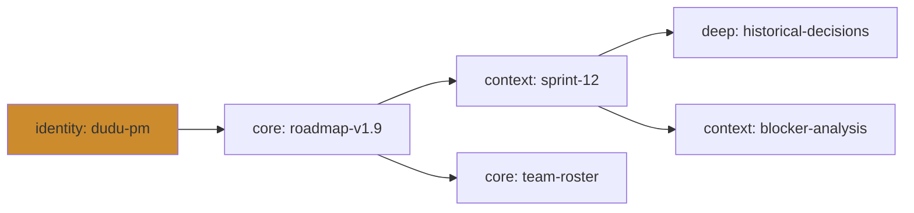

# Wiki Knowledge Layer

> 四層知識，依信任度加權：身分與核心事實常駐，深層典藏則按需取用。

---

## 比喻：醫師的診間

醫師走進診間時，心智距離不一的四個層級知識同時在場：

1. **身分** — 「我是陳醫師，一位心臟科醫師。」永遠在場。從不需檢索；那單純就是*他們是誰*。
2. **核心事實** — 「這位病人對盤尼西林過敏。今天是星期二。EHR 系統正常運作。」每次門診都需要。看一眼，不假思索。
3. **脈絡** — 「上週這位病人有異常心電圖；今天回診追蹤。」近期、相關、每日更新。
4. **深層典藏** — 「2019 年那篇關於罕見心律不整的論文。」只在某事提示其相關性時才檢索。

每次門診都把*全部*知識載入工作記憶會令人精疲力竭且適得其反。醫師的大腦依**注入頻率**將知識分層，DuDuClaw 的 Wiki 也是如此。

---

## 四個層級

受 [Vault-for-LLM](https://github.com/BurkhardHagmann/Vault-for-LLM) 四層知識架構啟發，每個 Wiki 頁面都宣告以下其中一種：

| 層級 | 符號 | 頻率 | 使用情境 |
|-------|--------|-----------|-----------|
| **L0 Identity** | `identity` | 注入每一段對話 | Agent／使用者身分、角色、使命 |
| **L1 Core** | `core` | 注入每一段對話 | 環境、進行中的專案、不變的規則 |
| **L2 Context** | `context` | 每日更新／按需 | 近期決策、除錯紀錄、當前 sprint |
| **L3 Deep** | `deep` | 僅搜尋、按需 | 知識典藏、歷史筆記、罕見參考 |

只有 L0 與 L1 會自動注入。L2 與 L3 需要明確的搜尋或更新。

```markdown
---
title: Agent Mission Statement
layer: identity
trust: 1.0
tags: [identity, mission]
---

I am duduclaw-pm, the project manager for the DuDuClaw
v1.9 roadmap. My authority extends to...
```

---

## 信任度加權

每個頁面在其 frontmatter 中都帶有一個 `trust` 分數（0.0 到 1.0）：

```
trust: 1.0   — Source of truth (contract, policy)
trust: 0.7   — Verified current information
trust: 0.4   — Auto-ingested, unverified
trust: 0.1   — Speculative, draft
```

搜尋結果依**信任度加權分數** = `fts5_rank × trust` 排名。一個高信任度但關鍵字相關度中等的頁面，會勝過一個低信任度但原始相關度較高的頁面。這可防止幻覺或自動抓取的內容在排名上勝過經人工整理的素材。

---

## 自動注入流程

注入發生在組裝 system prompt 時，分布在三個地方，因此每一種 runtime（Claude、Codex、Grok、OpenAI 相容，以及 catalog 裡的其他 runtime）都能得到相同的知識：

```
User sends message
     |
     v
Gateway routes to runtime
     |
     v
build_system_prompt(agent_id) assembles:
  ├─ Agent SOUL.md
  ├─ CONTRACT.toml (must_not / must_always)
  ├─ ## Your Team (sub-agent roster)
  ├─ Pinned instructions (session-scoped)
  ├─ Top-3 key facts (this conversation only)
  └─ WIKI_CONTEXT module:
       └─ Collect all pages WHERE layer IN (identity, core)
       └─ Budget-aware truncation by priority
     |
     v
Three paths use the same module:
  1. runner.rs        (CLI interactive)
  2. channel_reply.rs (Telegram/LINE/Discord/Slack/...)
  3. claude_runner.rs (dispatcher/cron delegation)
```

在 v1.8.9 之前，Wiki 透過 channel ingest 與 GVU 演化累積頁面，卻**從未把它們回饋**到 LLM 的 system prompt。Agent 擁有自己看不到的知識。自動注入閉合了這個迴圈。

---

## FTS5 全文索引

所有頁面（不論層級）都被索引在一個 SQLite FTS5 虛擬表中，使用 `unicode61` tokenizer。它能正確處理 CJK 字元：

```
write_page("api-design.md") ──┐
delete_page("old-spec.md") ───┤── auto-sync
wiki_rebuild_fts MCP tool ────┘   (manual rebuild)
     |
     v
WikiFts SQLite virtual table
     |
     v
Search queries:
  wiki_search("rate limiting", min_trust=0.5, layer="core")
  wiki_search("SOP", scope="shared", expand=true)
```

### 搜尋過濾器

```
min_trust: filter out draft/auto-ingest content
layer:     restrict to specific layer
expand:    1-hop backlink/related expansion
           (find pages linked-from and linking-to the hits)
```

### Backlink 擴展

Backlink 擴展會雙向追蹤 `related:` frontmatter 與本文 markdown 連結：

```
Search hit: "payment-flow.md"
     |
     v
Backlinks: pages that link TO payment-flow.md
  ├─ "refund-policy.md"
  ├─ "stripe-integration.md"
  └─ "checkout-audit.md"
     |
     v
Forward-links: pages that payment-flow.md links to
  ├─ "api-keys.md"
  └─ "webhook-handlers.md"
     |
     v
All 6 pages included in expanded result
```

這就是單次精準搜尋如何拉進一整個相關知識鄰域的方式。

---

## 知識圖譜

`wiki_graph` 會匯出 wiki 互連結構的 Mermaid 圖：



節點形狀依層級而異（identity = 圓形、core = 圓角矩形、context = 矩形、deep = 體育場形）。圖譜以 `center` 與 `depth` 參數做 BFS 限制，因此你可以匯出聚焦的子集，而非整個 wiki。

---

## 重複偵測

經過數月的自動匯入（channel 對話、GVU 反思），重複或近乎重複的頁面會逐漸累積：

```
wiki_dedup:
     |
     v
For each pair of pages:
  1. Title match (exact or fuzzy ≥ 0.9)
  2. Tag Jaccard similarity ≥ 0.8
     |
     v
Report candidate duplicates:
  [
    { "keep": "stripe-integration.md",
      "merge": "stripe-api-notes.md",
      "reason": "Tag Jaccard 0.88, title 0.95" }
  ]
```

這個工具不會自動合併；它只將候選浮現出來供人工審查。

---

## Shared Wiki

除了每個 Agent 各自的 wiki，還有一個位於 `~/.duduclaw/shared/wiki/` 的共享 wiki，用於跨越整個組織的知識：

```
~/.duduclaw/
├── agents/
│   ├── dudu/wiki/          ← per-agent knowledge
│   └── xianwen/wiki/       ← per-agent knowledge
└── shared/wiki/            ← cross-agent SOPs, policies, product specs
```

可見性透過每個頁面上的 `wiki_visible_to` capability 控制：預設為 agent 私有，但頁面可以提升為共享，或限制給某個團隊。

**一套工具，兩個 wiki。** `wiki_ls` / `wiki_read` / `wiki_write` / `wiki_search` / `wiki_stats` / `wiki_lint` 都吃一個 `scope` 參數：`"agent"`（預設，就是你自己的 wiki，行為不變）或 `"shared"`（跨 agent 的共享 wiki）。`wiki_share` 把你 wiki 裡的頁面複製進共享 wiki；`shared_wiki_delete` 保留原名，因為 agent-local 那側刻意沒有刪除入口。

六個 `shared_wiki_*` 寫法（`_ls` / `_read` / `_write` / `_search` / `_stats` / `_lint`）已在 v1.69.0 移除，不再出現在 `tools/list`，呼叫時會收到指名替代寫法的錯誤（`wiki_*` 帶 `scope="shared"`）。見[棄用與移除](../../guides/zh-TW/deprecations.md)。

### 命名空間 SoT 政策（`.scope.toml`）

操作者可以宣告共享 wiki 中哪些頂層命名空間是**某個外部系統的權威副本**（Notion、LDAP、治理政策套件），不得被演化中的 Agent 悄悄覆寫。放置一個 `~/.duduclaw/shared/wiki/.scope.toml`：

```toml
# Identity is owned by the IdentityProvider sync — no agent may write here
[namespaces."identity"]
mode         = "read_only"
synced_from  = "identity-provider"

# Access control list is owned by the governance policy bundle
[namespaces."access"]
mode         = "read_only"
synced_from  = "policy-registry"

# SOPs continue to be agent-writable (also the default for unlisted namespaces)
[namespaces."SOP"]
mode         = "agent_writable"

# Production policies are operator-only — never writable via MCP
[namespaces."policies"]
mode         = "operator_only"
```

三種模式：

| 模式 | Agents（MCP 路徑） | 與 `synced_from` 相符的內部 capability | 操作者 CLI |
|---|---|---|---|
| `agent_writable` | ✅ 允許 | ✅ 允許 | ✅ 允許 |
| `read_only` | ❌ 拒絕 | ✅ 允許 | ✅ 允許 |
| `operator_only` | ❌ 拒絕 | ❌ 拒絕 | ✅ 允許 |

`wiki_write`（`scope="shared"`）與 `shared_wiki_delete` 都會遵守該政策。未列出的命名空間預設為 `agent_writable`；該政策*只會收緊*，絕不放寬。

`.scope.toml` 不存在時維持原本預設；格式錯誤或無法讀取時拒絕存取，詳見下方政策規則。

**熱重載：** 政策會在每次 write／delete 時重新讀取（檔案很小；效能影響可忽略）。操作者的編輯立即生效。

寫入前可使用 `wiki_namespace_status` MCP 工具來檢視當前生效的政策。

### 部門級讀取可見範圍（`visible_to_departments`）

儀表板帳號的 `shared_wiki.pages`、`.read`、`.search`、`.stats` 與共享 Wiki 匯出也使用相同的部門規則。部門來自 `users.db` 中人類帳號的 `users.department`，不採用 AI 員工的部門或 token 內的資料。非管理員若沒有部門，只能讀公司頁面；管理員可讀全部。儀表板讀取遇到無法讀取或損壞的可見範圍設定時會拒絕；沒有 `.scope.toml` 時仍可讀公司頁面。分享頁面仍需要來源員工的 Owner 綁定或管理員權限。

上面的 `mode` 管的是「誰能寫入」一個命名空間。要管「誰能在**部門**層級讀取」，在同一個 `[namespaces."x"]` 表格底下加一個 `visible_to_departments` 陣列。只有 `[agent] department` 落在清單上的 Agent 才看得到那個命名空間，不論是**prompt 注入**（自動注入的 L0/L1 頁面），還是透過 **`wiki_search` / `wiki_read` / `wiki_ls`（`scope="shared"`）**。

```toml
# HR 頁面只有 hr 與 legal 部門能讀
[namespaces."hr"]
mode                   = "operator_only"   # 寫入：僅限操作者
visible_to_departments = ["hr", "legal"]   # 讀取：僅限 hr + legal 部門
```

這與寫入用的 `mode` 是正交的：一個命名空間可以同時宣告兩者、只宣告其中一個，或都不宣告。Agent 的部門來自其 `agent.toml` 裡的 `[agent] department`（空值/未設定 = 沒有部門）。

對任何有宣告的命名空間都是 **fail-closed**：部門不在清單上的 Agent（包括**沒有部門**的 Agent）一律拒絕。只做精確的部門比對（不做前綴/子字串比對）。清單為空則拒絕所有人。

根目錄政策有效或不存在時，未宣告部門限制的命名空間仍可讀取；政策格式錯誤時，所有命名空間都不對 AI 開放。

這一層疊在內建的 `departments/<dept>/` 隔離之上（見下方「部門知識分層」）：`departments/art/*` 無論 `.scope.toml` 怎麼設，永遠只對 `art` 部門可見；而 `visible_to_departments` 讓操作者可以把*任何*命名空間（`hr/`、`finance/` 等）限制給指定部門。`wiki_namespace_status` 會列出目前生效的 `visible_to_departments` 宣告。

**名稱怎麼比對（v1.84.0）。** 頁面路徑中的 `/` 與 `\` 在所有平台上都是同一種分隔符號，所以 `departments\hr\pay.md` 和 `departments/hr/pay.md` 是同一頁。部門資料夾與 `.scope.toml` 命名空間只有在名稱完全相符時才會開放。只差大小寫、結尾多了句點或空白，或 Unicode 組字方式不同（NFC 與 NFD）的名稱，會被當成受保護名稱的別名而拒絕：`hr` 部門的員工讀不到 `departments/HR/pay.md`，AI 員工不能透過已宣告命名空間的別名讀取，透過別名寫入也一律被拒。部門代號和 v1.83.0 一樣區分大小寫。兩個 `[namespaces."…"]` 依這些規則指向同一個資料夾時（例如 `HR` 與 `hr`），AI 員工一律不能讀取這個資料夾，寫入則連操作者也被拒絕，直到管理員刪掉重複的那一筆；閘道對每個資料夾記錄一次警告。

### 部門知識與 Skill 分層

知識與 Skill 採**公司 → 部門 → 個人**分層：

- **Wiki：** `shared/wiki/departments/<dept>/` 底下的頁面只對 `[agent] department` 相符的 Agent 可見；公司層（其他所有命名空間）對所有人開放。讀取隔離永遠強制執行。
- **Skill：** 三層依 **per-agent > 部門 > 全域**的優先序合併（名稱衝突時最近的層級勝出）：
  - 全域 — `~/.duduclaw/skills/`（所有 Agent）
  - 部門 — `~/.duduclaw/shared/skills/departments/<dept>/`（僅限 `<dept>` 部門的 Agent）
  - per-agent — `<agent>/SKILLS/`

透過 `skill_hub_install` MCP 工具、帶 `scope = "department:<name>"`（或 `"global"` / 指定 agent id）可以把 Skill 裝進部門層。沒有部門的 Agent 就只看得到全域層與 per-agent 層。

---

## Cloud Ingest 整合

當 channel 對話或外部文件被匯入時，匯入器會指派合理的預設值：

```
Auto-ingested content defaults:
  ├─ Source pages:   layer: context, trust: 0.4
  └─ Entity pages:   layer: deep,    trust: 0.3
```

預設為低信任度；Agent 可以在驗證後提升到更高層級。Cloud Ingest 的 prompt 明確指示 LLM 在萃取期間指派 `layer` 與 `trust`，因此原始輸入抵達時便已附帶合理的初步估計。

---

## 自動建檔（`auto/` 命名空間，WP5c）

以前在通道貼一份公司章程什麼都不會留下：蒸餾分類器看的是**助理回覆長度**，兩千字的文件配一句「好的」就整條管線跳過。WP5c 補上第二個 sink。

**判別**（`knowledge_route.rs`，決定性案例零 LLM 成本）：

| 層 | 規則 |
|---|---|
| L0 排除 | 少於 80 字 · 短提問 · `scan_input` 任一命中 · LLM fallback 敘事 |
| L1 訊號 | 文件性名詞（+40）、明示建檔動詞（+50）、`第…條` ≥2 次（+35）、≥3 行編號條列（+25）、markdown 結構（+10）、長度（+15/+30）、標題行（+10）；扣分：第一人稱偏好（−45）、時效情境（−35）、代名詞密度（−20）、多重提問（−25） |
| 閾值 | ≥65 建檔 · 30–64 交小模型仲裁 · <30 走記憶 |

判別**只看使用者文字**，且在 `classify_for_ingest` 之前執行。

**頁面位置**：該 AI 員工自己的 `auto/{charter,sop,spec,policy,reference}/<slug>.md`。人工策展目錄（`entities/`、`concepts/`、`sources/`、`synthesis/`）在這條路徑上不可達。

**自動頁與人工頁的差別**：

| | 自動建檔 | 人工策展 |
|---|---|---|
| `author` | `auto-distill` | operator / agent id |
| `tags` | 含 `auto-distilled` | — |
| `layer` | `context`：**永不自動注入** | `identity` / `core` 會注入 |
| `trust` | `0.300`（`channel` 來源上限） | 最高 `1.0` |
| `source_type` | `raw_dialogue`（排序係數 0.6） | `verified_fact`（1.2）等 |
| 可搜尋 | 是（刻意不設 `do_not_inject`） | 是 |

「不注入」是整份設計的風險支點：判別錯誤的代價僅是知識庫多一頁，不至於讓每一次回覆的系統提示都被污染。

**決定性**：頁面 key 為 `auto/<doc_type>/<slug>.md`，`slug` 取小模型提案並以 `^[a-z0-9][a-z0-9-]{0,63}$` 嚴格驗證，不合格則退回 `<doc_type>-<sha8(NFKC 正規化標題)>`。內容相同再貼一次不寫檔；內容不同則覆寫並在版本紀錄追加一行。

**四道閘門，全部 fail-closed，全部退回記憶路徑**：

1. `.scope.toml`：`[namespaces.auto]` 可設 `operator_only` 或指向其他 capability 的 `read_only` 來關閉自動建檔。與共享 wiki 相同，檔案存在但解析失敗會**停止**寫入。
2. 對整頁文字跑 `scan_input`，任一規則命中即丟棄。
3. 同源爆量偵測（`knowledge_guard`）。
4. 每日斷路器：每位 AI 員工每天 20 頁 + 20 次灰帶仲裁。

**記憶只留指標，不留全文**：一列 `subject = wiki:auto/<doc_type>/<slug>`、`predicate = documented_in`，`store_temporal` 會自動接替舊指標，策展台移除時也能精準讓這一頁的指標失效。

**管理介面**：儀表板側欄 → 記憶 → 個人知識庫（個人版為「知識庫」）→ 策展台 → 自動建檔（檢視／確認為正式知識／分享到共享知識庫／移除）。

**對話範圍（v1.84.0）。** 在通道對話中，自動頁面只有產生它的那段對話看得到，而且閘道自己的登記檔 `<home>/state/wiki-auto/<agent>.json`（只有擁有者能讀寫）必須有這一頁的紀錄，記下的 SHA-256 也要和檔案內容（閘道寫入時的原樣）完全相符。紀錄裡存有頁面的來源（`host_sources`）與是否經人確認（`host_promoted`）；頁面裡的同名欄位要和紀錄一致才算數，`author`、`sources`、`layer` 不提供任何權限。未確認的頁面，只有在每一筆來源都是這段對話時才會顯示；主管或管理員在策展台確認過的頁面，每段對話都看得到。沒有相符紀錄的頁面，任何對話都看不到：包括 v1.84.0 以前建立的頁面（含先前已確認的）、早期 v1.84.0 建置留下的頁面，以及在 DuDuClaw 之外被改過的頁面。登記檔不存在或讀不到時，所有自動頁面都會隱藏。另一段對話整理出同一個 slug 時，會另建 `auto/<type>/<slug>-<8 位十六進位>.md`，後綴取自對話的雜湊值（不會放對話代號），不同對話的頁面不會合併。建檔、確認與維護時的改寫共用鎖檔 `<home>/locks/wiki-auto/<agent>.lock`，不再建立 `<wiki>/.auto-pages.lock`。要讓隱藏的頁面重新出現，請用 `wiki.promote` 確認（需要主管角色或管理員，加上該員工的 Owner 權限）；確認會記下目前的內容，沒有可用紀錄的頁面則記下 `host_sources: ["legacy:human-confirmed"]`，內容與其他欄位不變。儀表板的系統檢查 `legacy_auto_wiki` 會列出每位員工有多少頁沒有登記紀錄（訊息目前只有繁體中文）。從儀表板把自動頁面分享到共享知識庫（`wiki.share`）同樣需要主管加上 Owner 權限，而且只能分享已確認的頁面；共享副本的來源取自登記紀錄。任何 AI 工具範圍都不能寫入或分享 `auto/`：聊天回合、排程與交辦工作的 `wiki_write`、`wiki_share` 一律拒絕（包括 `AUTO/`、`auto./` 這類變形），員工檔案守衛也會擋下對自己 `wiki/auto/**` 的 Write／Edit（Bash 規則只是減速帶）。在通道對話中，`wiki_export` 直接拒絕，`wiki_read` 讀看不到的頁面時回覆和頁面不存在相同，`wiki_ls`、`wiki_search`（在排序前過濾）、`wiki_lint`、`wiki_stats` 都不包含看不到的頁面，`_index.md` 與 `_log.md` 裡提到 `auto/` 的行也會移除，包括這段對話自己的頁面（這些頁面仍可用 `wiki_ls`、`wiki_search` 找到）。已知缺口：`wiki_dedup`、`wiki_graph`、`wiki_rebuild_fts`、`wiki_trust_audit`、`wiki_trust_history` 尚未套用這項可見範圍規則。

**頁面名稱（v1.84.0）。** 新頁面的路徑中，任何一段都不能以句點或空白結尾、不能是 Windows 裝置名稱（`CON`、`PRN`、`AUX`、`NUL`、`COM0`～`COM9`、`LPT0`～`LPT9` 等，以第一個句點之前的部分判斷），也不能含控制字元；`:` 只在 Windows 上拒絕。已經存在的這類頁面在 macOS 與 Linux 上仍可讀取、列出與搜尋，但不能寫入、分享或確認為正式知識。

---

## CLAUDE_WIKI 範本

現在每個新 Agent 的 `CLAUDE.md` 都包含一個 CLAUDE_WIKI 範本，教導 LLM 如何使用 wiki 工具：

```markdown
## Wiki Knowledge Base

You have access to a persistent wiki at <agent>/wiki/.
Use these tools to retrieve and update knowledge:

- wiki_search(query, min_trust, layer, expand)
- wiki_read(page_name)
- wiki_write(page_name, content, layer, trust)
- wiki_graph(center, depth)
- wiki_dedup()

L0 Identity + L1 Core pages are auto-injected — you don't
need to call wiki_read for those. Call wiki_search when
you need historical context or deep references.
```

在這個範本出現之前，Agent 雖然有 wiki 工具的存取權，卻很少使用，因為它們不知道 wiki 的存在或慣例。這個範本填補了那個指示缺口。

---

## 為什麼這很重要

### 訊號重於雜訊

自動注入 L0+L1 頁面，大致等同於讓醫師的身分與當前病人的過敏狀況永遠在視野內。你不必翻遍病歷去找它們。

### 信任度作為一等訊號

`trust` 分數意味著 Agent 可以對自身知識的可靠性進行推理：「這個模式信任度 0.3，行動前我應該先驗證。」知識不是布林值（存在／不存在），它是一種分布。

### Runtime 無關

每一種 runtime 都看到相同的 wiki，因為注入發生在 runtime 邊界*之前*，在 `build_system_prompt` 中。

### 閉合累積迴圈

在 v1.8.9 之前，從 LLM 的視角來看，Wiki 是唯寫的：人人都能寫，沒人能讀（除非透過 LLM 很少發起的明確 `wiki_search` 呼叫）。現在每段對話都會自動讀取 identity + core 層級。

---

## 與其他系統的互動

- **Skill 生命週期**：技能萃取會諮詢 wiki 以取得脈絡。從記憶合成的技能可以引用支持它的 wiki 頁面。
- **安全性**：包含機密的 wiki 頁面會被那個對其他可寫面執行的同一個掃描器標記。CONTRACT.toml 中的 `must_not` 規則可以限制 Agent 被允許寫入哪些層級。
- **Dashboard**：Knowledge Hub 頁面以層級過濾器與圖譜視覺化呈現 wiki。

---

## 總結

知識不是一堆扁平的文件，它依你需要看到它的頻率分層。DuDuClaw 的 Wiki 將這種分層明確化、為每個頁面加上信任度權重，並將「必須永遠記住」那一層直接自動注入每一個 system prompt。深層典藏則保持安靜，直到被召喚。

### 頁面名稱、政策與掃描範圍

既有頁面以磁碟上的最終檔名作為身分，信任隔離與自動頁面登記也使用這個名稱。大小寫或 Unicode 組合寫法不同時，會解析成同一頁；若資料夾內有多個比對後相同的檔名，則拒絕存取。保留檔也採相同判斷：讀取 `_INDEX.md` 仍會移除不可見的索引內容，不能把它當一般頁面覆寫。寫入仍拒絕結尾的點號與空白；讀取別名則依平台規則解析成同一頁或拒絕。

只有知識庫根目錄的 `.scope.toml` 會生效。檔案不存在時維持原本預設；無法讀取、檔案為連結、超過 64 KB、TOML 格式錯誤或欄位型別不正確時，會停止相關寫入、AI 讀取與注入，以及儀表板讀取與匯出。儀表板政策編輯器支援 `agent_allowlist` 與 `agents` 清單。升級前可執行 `duduclaw doctor` 或儀表板系統檢查，找出政策錯誤；檢查也會提醒子資料夾中的 `.scope.toml` 不會生效。請修好根目錄政策後再重試。

列表、搜尋、注入與匯出共用深度上限為 20 的掃描器，略過第一層 `_archive`（含等價寫法）、保留檔與內部連結，並拒絕以連結作為起點。無效或有歧義的頁面 ID 會略過，數量記入掃描與匯出紀錄。兩條寫入路徑都拒絕連結形式的 `_index.md`、`_log.md`、`_index.lock` 與 `.scope.toml`，包括斷掉的連結。

信任設定寫入時保存磁碟上的實際頁面 ID；讀取時合併舊有的分隔符號、大小寫、Unicode、不可見字元及結尾點號／空白別名，採最低信任值，並保留任何 `do_not_inject` 標記。無法解析或有歧義的頁面不會提供內容。頁面與控制檔讀寫拒絕路徑中的符號連結及 junction，包括指向知識庫內部的目錄連結。每個目錄最多 10,000 筆，超過即拒絕解析或掃描；掃描器對每個目錄只列舉一次。`knowledge_owner` 只接受 `memory` 或 `wiki`，其他值會使整份政策載入失敗。ActionGuard 核准模擬只採用 `read_only`、`operator_only` 命名空間；`agent_allowlist` 仍可由員工寫入，因此不作為判斷依據。
