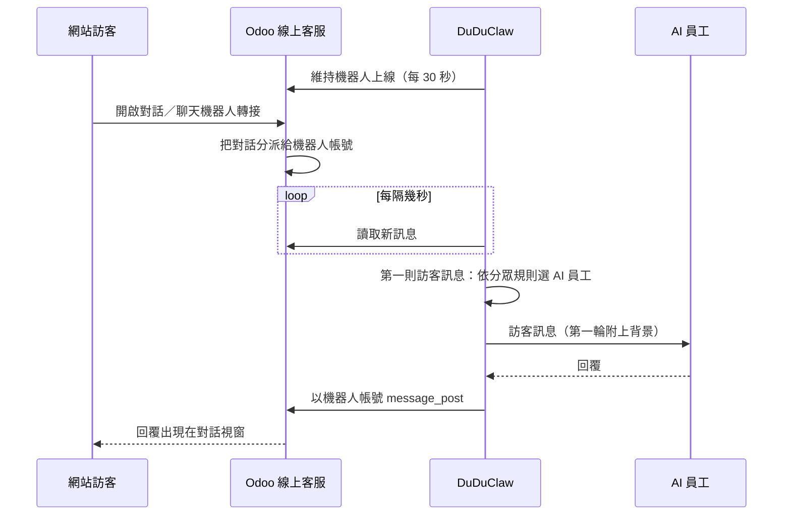

# Odoo 網站線上客服

讓 AI 員工回覆 Odoo 網站線上客服（Live Chat）的訪客，並依「分眾規則」決定哪位 AI 員工接哪位訪客。VIP 會員交給 VIP 專屬顧問，問退貨的交給退貨專員，其他人交給一般客服。你的同事一進對話開口，AI 就停話。

預設關閉。設定位置：**管理 → 整合 → Odoo → 網站線上客服**。

---

## 運作方式

DuDuClaw 以一般**客服人員**的身分加入你的線上客服。你在 Odoo 建一個專用的內部使用者（例如「AI 客服」），把它加進線上客服頻道的客服人員，DuDuClaw 負責讓這個帳號保持上線。Odoo 就會像分派給真人一樣把訪客對話分派給它：直接分派，或在聊天機器人腳本走到「轉給客服人員」那一步時轉過來。DuDuClaw 每隔幾秒用 JSON-RPC 讀取訪客訊息，再以這個帳號在對話裡回覆。

為什麼當客服人員，而不是做成聊天機器人腳本？Odoo 的對話視窗在腳本最後一步跑完後會鎖住訪客的輸入框（顯示「This conversation has ended.」），除非有找到客服人員。光靠腳本撐不起開放式對話，所以 AI 必須是腳本轉過去的那位客服人員。Odoo 也只會把對話分派給顯示「上線」的客服人員，因此 DuDuClaw 要負責維持機器人帳號的上線狀態：

| Odoo 版本 | 機器人怎麼保持上線 |
|---|---|
| 17 / 18 | 機器人帳號自己呼叫 `bus.presence.update_presence` |
| 19 | 只有管理員能寫入上線狀態，DuDuClaw 透過 `[odoo]` 連線帳號寫入機器人的 `mail.presence`，該帳號需具備「管理員」角色 |

關閉這項功能、或閘道正常關機時，機器人會被設為離線，Odoo 就不再派訪客給它。



## 設定步驟

在 Odoo（17 以上，已安裝線上客服模組）：

1. 到「設定 → 使用者」建立機器人用的內部使用者，例如「AI 客服」，權限給「線上客服：使用者」。訪客會看到這個名稱。
2. 以這個帳號登入，到「偏好設定 → 帳戶安全 → 新增 API 金鑰」產生金鑰。
3. 到「線上客服 → 設定 → 頻道」打開頻道，把機器人帳號加入「客服人員」。想讓 AI 接所有對話，就讓它成為唯一的客服人員；若同時有真人上線，Odoo 會在他們之間輪流分派。
4. 選用：讓聊天機器人腳本先招呼訪客，在某個分支的最後放「轉給客服人員」。AI 從那裡接手，你也可以依是哪個腳本轉過來來分流。

在 DuDuClaw：

1. 先在 Odoo 分頁上方完成 Odoo 連線設定（若還沒設）。
2. 在「網站線上客服」填入機器人帳號與 API 金鑰，按「測試機器人帳號」。測試會以機器人身分登入，列出線上客服頻道（以及機器人是否為該頻道的客服人員）、聊天機器人腳本和 Odoo 使用者。機器人與 `[odoo]` 連線帳號相同、還不是任何頻道的客服人員、或 Odoo 19 需要管理員角色時，都會出現提醒。
3. 選擇「預設 AI 員工」，視需要填開場白、轉接真人時要邀請的 Odoo 使用者，以及分眾規則。
4. 打開開關並儲存。幾秒內生效，不用重啟。

請挑專門服務客戶的 AI 員工。網站訪客什麼都能打，這類員工只給客服對話用得到的工具（例如 `allowed_tools = ["mcp__duduclaw__wiki_search"]`），並準備好可以依據回答的產品知識（Wiki 頁面）。不知道價格的 AI 員工會自己編一個價格出來。

## 分眾規則

每段對話在訪客的第一則訊息時比對一次，由上往下，第一條「已啟用且條件全部符合」的規則決定 AI 員工；都不符合就交給預設 AI 員工。決定後整段對話不換人，訪客不會聊到一半換了一個人。

| 條件 | 值的來源 |
|---|---|
| 線上客服頻道 | 服務這位訪客的 `im_livechat.channel` |
| 經由聊天機器人轉入 | 把訪客轉給客服人員的聊天機器人腳本（腳本分支就是訪客自己選的主題） |
| 訪客類型 | 已登入網站的會員（Odoo 聯絡人）或未登入的訪客 |
| 客戶標籤 | 已登入會員的聯絡人標籤，例如 `VIP` |
| 國家代碼 | Odoo 依訪客 IP 判斷的國家（`TW`、`JP`） |
| 語言 | 訪客的 Odoo 語言；`zh_TW` 只比對繁中，`zh` 比對所有中文 |
| 訊息關鍵字 | 訪客目前為止說的話，包含在聊天機器人點選的選項 |

同一條規則內，填了的條件都要符合；同一欄填多個值時，符合其一即可。沒有任何條件的規則會符合所有人，可以當最後的兜底規則。Odoo 不知道的值（未登入訪客的標籤、判斷不出的國家）視為不符合。

Odoo 本身就能用頻道規則（`im_livechat.channel.rule`：網址正規式、國家、聊天機器人）依頁面和國家分流。要依網址分眾，先在 Odoo 把不同頁面導到不同頻道或聊天機器人，再在這裡依頻道或聊天機器人分派。DuDuClaw 不自己讀取網址。

### 還有哪些分眾方式，以及為什麼這次沒做

挑選上面的條件之前，我們查過 Odoo 17～19 透過 API 能拿到哪些訪客資訊：

- **瀏覽過的頁面與 UTM 來源**：`website.visitor` 有記錄瀏覽頁面，但讀取需要額外的網站權限，機器人平常用不到；Odoo 也不會把 UTM 參數或來源網址存到對話上。常見需求用 Odoo 自己的網址規則就能涵蓋。
- **價目表、公司或個人、客戶等級**：已登入會員可以讀到，但要裝銷售與會計模組才有。客戶標籤能滿足同樣需求，又不綁模組。
- **同一位 AI 員工依分眾換語氣**：做得到，但每個客群各用一位 AI 員工，指示、知識與工具清單才能分開維護和測試，所以分眾的單位是 AI 員工。
- **LINE、Telegram 等通道也套用同一套規則**：這些通道對發話者知道得少很多（沒有標籤、沒有國家），而且已經能用「每位員工一個機器人」或綁定來分派。規則引擎本身不綁通道（`duduclaw_odoo::livechat::route`），等某個通道提供類似的資訊就能沿用。

## 真人接手與轉接

- **真人開口**：Odoo 內部使用者（機器人以外）一在對話中發言，AI 就停止回覆這段對話，不用按任何按鈕。
- **訪客要求真人**：訪客訊息含轉接關鍵字（預設：真人、人工客服、轉接客服、human），且你有選要邀請的 Odoo 使用者時，DuDuClaw 會把他們加進對話、送出轉接訊息後停話。沒選人時 AI 會繼續自己回覆。
- **對話裡已經有真人**：DuDuClaw 第一次看到某段對話時（例如重啟後），如果裡面已經有其他內部使用者，就保持安靜。
- **AI 回覆途中**：AI 還在產生回覆時真人開口了，這則 AI 回覆會被丟棄。
- **交回 AI**：設定頁的「進行中的對話」列出每段對話、命中的分眾規則與負責的 AI 員工，以及是否已由真人接手。按「交回 AI」後，從訪客的下一則訊息起由 AI 回覆。

## 隱私與安全

- 訪客訊息走和其他通道相同的回覆流程（輸入檢查、行為契約、去識別化還原）。
- 訪客看不到給管理者的系統訊息。AI 無法回覆時（沒有可用帳號、模型錯誤），訪客只會收到一句簡短的道歉，真正原因寫進儀表板的通道失敗紀錄。「規則已變更」這類通知也不會出現在訪客對話。
- 回覆送出前會做 HTML 跳脫，回覆內容無法在你的網站上注入任何標記。
- 對話識別碼包含 Odoo 網址與資料庫的雜湊值。每個 Odoo 資料庫的對話編號都從 1 開始，兩位訪客絕不能共用同一段歷史，所以把 DuDuClaw 改接另一個 Odoo 時，也會清掉先前存下的對話狀態。
- 機器人金鑰加密保存，不會回傳到儀表板；每次儲存都寫入稽核紀錄。

## 限制

- 已在實際運作的 Odoo 18.0 與 19.0 驗證（2026-10-12）。Odoo 17 的原始碼使用相同的模型與方法，但沒有在實機上測試。
- 回覆時間是輪詢間隔（預設 4 秒）加上模型產生回覆的時間。
- 閘道若是當機而非正常關機，Odoo 會繼續顯示機器人上線（Odoo 12 小時後才清掉過期的上線狀態），在 DuDuClaw 恢復前可能還會派新對話給它。重啟後 DuDuClaw 會回覆 30 分鐘內的訊息。這段空窗會造成困擾的話，請在頻道裡保留一位真人客服。
- Odoo Online 只有 Custom 方案能使用 API。
- 請使用專用的機器人帳號。沿用連線帳號時，訪客看到的是那個人的名字，那個人本人在對話中發的訊息也無法和機器人區分。

## 設定參考

設定頁寫入的 `config.toml`：

```toml
[odoo_livechat]
enabled = true
bot_username = "ai-support@example.com"   # 留空：沿用 [odoo] 帳號（不建議）
# bot_api_key_enc = "…"                    # 由儀表板設定，加密保存
livechat_channel_ids = []                  # 留空：Odoo 分派給機器人的所有對話
poll_interval_seconds = 4                  # 2～60
default_agent = "front-desk"               # 留空：主要 AI 員工
greeting = ""                              # 新對話先送一次；留空不送
handoff_user_ids = [2]                     # 轉接時邀請的 Odoo res.users 編號
handoff_keywords = ["真人", "人工客服", "轉接客服", "human"]
handoff_message = "好的，已為您轉接真人客服，請稍候。"

[[odoo_livechat.audience_rules]]
name = "VIP 會員"
agent = "vip-concierge"
visitor = "logged_in"                      # any | logged_in | anonymous
partner_tags = ["VIP"]

[[odoo_livechat.audience_rules]]
name = "退換貨"
agent = "returns"
keywords = ["退貨", "換貨", "refund"]

[[odoo_livechat.audience_rules]]
name = "報價聊天機器人分支"
agent = "sales"
chatbot_script_ids = [1]
```

儀表板 RPC（僅限管理員）：`odoo.livechat.get`、`odoo.livechat.set`、`odoo.livechat.test`、`odoo.livechat.status`、`odoo.livechat.resume`。
